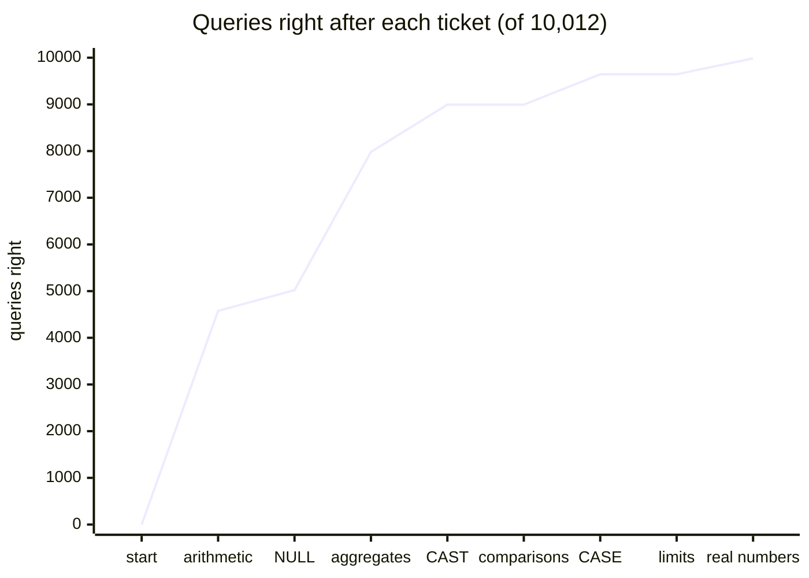
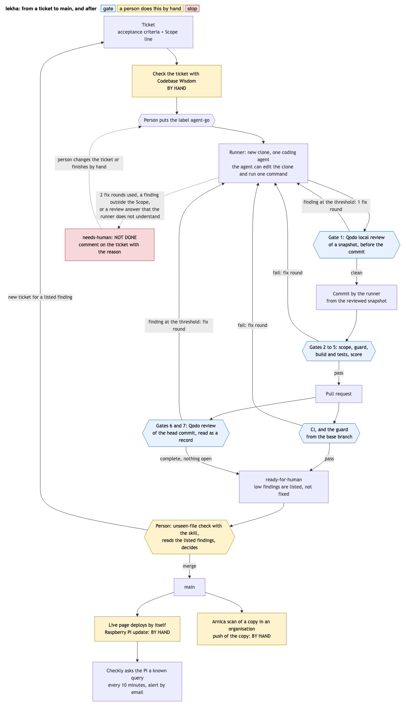

# lekha

A small SQL database that gives the same answers as SQLite.
AI coding agents write it, SQLite's public test suite scores it, and Qodo reviews each change before it merges.
"Lekha" is Sanskrit for a written record.

**Try it in your browser: https://bettersandeep.github.io/lekha/**
The page runs the engine in your browser, and its second button asks the same engine on a Raspberry Pi.

**Score: 9,986 of 10,012** queries of one SQLite test file give the same answer as SQLite.
On 20,024 more queries that the agents never saw, 19,987 are right and 0 give a wrong value.
Each miss is an error that says "not supported".

| Ticket | Pull request | Score after |
|---|---|---|
| [#2](https://github.com/bettersandeep/lekha/issues/2) integer arithmetic | [#4](https://github.com/bettersandeep/lekha/pull/4) | 4,577 |
| [#10](https://github.com/bettersandeep/lekha/issues/10) NULL, COALESCE, NULLIF | [#12](https://github.com/bettersandeep/lekha/pull/12) | 5,021 |
| [#11](https://github.com/bettersandeep/lekha/issues/11) COUNT, MIN, MAX, SUM | [#14](https://github.com/bettersandeep/lekha/pull/14) | 7,981 |
| [#18](https://github.com/bettersandeep/lekha/issues/18) CAST to INTEGER | [#19](https://github.com/bettersandeep/lekha/pull/19) | 8,995 |
| [#20](https://github.com/bettersandeep/lekha/issues/20) comparisons, AND, OR, NOT | [#23](https://github.com/bettersandeep/lekha/pull/23) | 8,995 |
| [#24](https://github.com/bettersandeep/lekha/issues/24) CASE | [#30](https://github.com/bettersandeep/lekha/pull/30) | 9,644 |
| [#13](https://github.com/bettersandeep/lekha/issues/13) SQLite's limits | [#33](https://github.com/bettersandeep/lekha/pull/33) | 9,644 |
| [#45](https://github.com/bettersandeep/lekha/issues/45) real numbers, CAST to REAL, AVG | [#56](https://github.com/bettersandeep/lekha/pull/56) | 9,986 |

## The factory

This repo is an entry in the Qodo Software Factory Hackathon.
It holds two things: the database, and the factory around it, which has the name yantra.
The factory is the working process that takes a ticket to a reviewed pull request, and to a person who decides.

Blue is a gate, yellow is a step that a person does by hand, red is a stop.
The source of the picture is `docs/factory.mmd`.

- `AGENTS.md`: the rules for the agents and the quality gate. Each rule names the check behind it.
- `yantra/`: the runner. `yantra/README.md` has the flow, the labels and the limits of the agent.
- `ci/guard.sh`: a pull request cannot change the engine and the things that measure it in one change.
- `.claude/skills/unseen-check/`: the check on SQLite test files that the agents never see.
- `.pr_agent.toml`: the setup of the Qodo review.
- Branch [`evidence`](https://github.com/bettersandeep/lekha/tree/evidence): the saved reviews, logs and screenshots that the hackathon posts link to.

## Rule of this repo

The first commit is a seed that did not come through a pull request: an empty crate, CI and the licence.
Each change after the seed arrives as a pull request with a Qodo review.

## Design decisions

- Language: Rust, with no dependencies.
- Answers: the same as SQLite, checked with SQLite's public test suite.
- When the engine does not support an input, it returns an error. It never returns a guessed value.

## Tests

`tests/slt.rs` runs each `*.test` file under `tests/slt/` against a new database.
The files use the sqllogictest format of SQLite.
A record passes when the engine gives the same result as SQLite.
Records that are only for other databases do not count.
A record that gives only an md5 hash of its result counts as failed, because the harness has no md5.
The harness fails when it does not understand a line of a test file.

The test prints one line for each file: `slt: <file> <passed>/<applicable>`.
`<applicable>` is the number of records that apply to SQLite.
`<passed>` is the number of these records that pass.

`tests/slt/baseline.txt` holds the exact `<passed>` number of each file.
The test fails when the measured number is not equal to the number in the baseline.
A change that makes more records pass must set the new number in the baseline.
The number must not go down.

`SLT_FAILURES=20 cargo test -- --nocapture` also prints the first 20 records that fail in each file.

### Test data

`tests/slt/random/expr/slt_good_0.test` is the file `test/random/expr/slt_good_0.test` from https://github.com/gregrahn/sqllogictest at commit `c93ac416f05635ff5cc490009add936d9753d01d`.
That repository is a git mirror of https://www.sqlite.org/sqllogictest/.
The sha256 of the file is `90af1bebe0f8320c0221907bd7bcf1942c5bdf9ba9cf95642fe851136b9db42c`.
The licence of the file is in `tests/slt/COPYRIGHT.md`.
The author offers GPL, BSD, MIT or CC0, and this repo uses the file under MIT.

## Status

The engine runs `SELECT [ALL | DISTINCT] <item> {, <item>}` without `FROM`.
An item is an expression with an optional alias.
An expression can use integer literals, `NULL`, unary `+` and `-`, binary `+ - * / %`, the comparisons `= == <> != < <= > >=`, `IS NULL`, `IS NOT NULL`, `NOT`, `AND`, `OR`, parentheses, `COALESCE`, `NULLIF`, `COUNT`, `MIN`, `MAX`, `SUM`, `AVG`, `CAST(<expr> AS INTEGER)`, `CAST(<expr> AS REAL)` and `CASE`.
The precedence of the operators is the table in section 2 of https://www.sqlite.org/lang_expr.html, and operators of one row group from left to right.
A comparison gives 1 or 0, and NULL when an operand is NULL.
`IS NULL` and `IS NOT NULL` give 1 or 0.
`NOT`, `AND` and `OR` follow the three-valued logic of SQLite: a value is true when it is not 0 and not NULL, `NULL AND 0` is 0, `NULL OR 1` is 1, and `NOT NULL` is NULL.
A `NOT` can be the operand of another operator, and it then takes the rest of the expression up to the next `AND` or `OR`: `- NOT 0 = 5` is `- (NOT (0 = 5))`, as in SQLite.
The engine computes both operands of `AND` and `OR`, so an error in the right operand is an error for the statement.
Each other operator is an error: `~`, `||`, the bit operators, `BETWEEN`, `IN`, `LIKE`, `GLOB`, `ISNULL`, `NOTNULL`, `NOT NULL` as a postfix, `IS DISTINCT FROM`, and `IS` or `IS NOT` with a right side that is not the literal `NULL`.
`1 IS NULL + 1` is also an error, because SQLite reads it as `1 IS (NULL + 1)`.
The arithmetic follows SQLite.
Division truncates toward zero.
The result of `%` has the sign of the left operand.
Division or modulo by zero gives NULL.
Arithmetic with a NULL operand gives NULL.
`COALESCE` takes two or more arguments and returns the first one that is not NULL, or NULL when all are NULL.
`NULLIF` takes two arguments and returns NULL when they are equal, and the first argument in each other case.
A `SELECT` without `FROM` has one row, so each aggregate function sees one value.
`COUNT(*)` returns 1.
`COUNT` with one argument returns 1 when the argument is not NULL, and 0 when it is NULL.
`MIN`, `MAX` and `SUM` take one argument and return it.
`AVG` takes one argument and returns it as a real number, or NULL when it is NULL.
The argument of an aggregate function can start with `ALL` or `DISTINCT`.
An aggregate function inside the argument of an aggregate function is an error.
`MIN` and `MAX` with two or more arguments are errors.
Function names are case-insensitive.
A value is an integer, a real number or NULL.
A real number comes from `CAST(<expr> AS REAL)`, from `AVG` and from arithmetic with a real operand.
A real literal such as `1.5` is an error.
`+`, `-`, `*` and `/` give a real number when one operand is real, and unary `-` keeps a real number real.
`%` casts both operands to INTEGER, and with a real operand its result is a real number.
A real number divided by zero gives NULL, and so does `%` when the right operand is 0 after the cast.
An integer and a real number compare by their exact numbers: `CAST(9223372036854775807 AS REAL) = 9223372036854775807` is 0.
A real number is true when it is not zero.
A real result that is not a finite number is an error. SQLite keeps an infinity.
Integer overflow is an error too. SQLite changes to a real number there.
`CAST(<expr> AS INTEGER)` returns an integer without change.
It truncates a real number toward zero, and a real number outside the range of an integer gives the nearest limit of the range.
`CAST(<expr> AS REAL)` returns the value as a real number.
A `CAST` of NULL gives NULL.
`CAST`, `AS`, `INTEGER` and `REAL` are case-insensitive.
A `CAST` to each other type is an error, and so is a `CAST` with no type.
`lekha::real_text` gives the text of a real number as SQLite's `CAST(<real> AS TEXT)` gives it, for example `1.0`, `3.5` and `9.22337203685478e+18`.
The server and the browser page print a real number with it.
The rules for real numbers are measured on SQLite 3.46.1, and the comments in `src/select.rs` and `src/lib.rs` have the queries.
The engine computes each argument of a function, so an error in an argument is an error for the statement.
`CASE WHEN <cond> THEN <result> {WHEN <cond> THEN <result>} [ELSE <result>] END` gives the result of the first `WHEN` whose condition is true, which means not 0 and not NULL.
`CASE <base> WHEN <value> THEN <result> {WHEN <value> THEN <result>} [ELSE <result>] END` gives the result of the first `WHEN` whose value equals the base, and a NULL base or a NULL value never matches.
With no match, a `CASE` gives the `ELSE` result, or NULL when there is no `ELSE`.
The rules are from section 7 of https://www.sqlite.org/lang_expr.html.
The keywords of a `CASE` are case-insensitive.
A `CASE` with no `WHEN`, a `WHEN` with no `THEN` and a missing `END` are errors.
The engine computes each part of a `CASE`, so an error in a part that SQLite does not compute is an error for the statement.
The engine returns an error for each other statement, expression or function, for a wrong number of arguments and for integer overflow.
A SQLite keyword is not accepted as an alias.
An expression that is nested more than 100 levels deep is an error.
This is the engine's own limit on parentheses, unary operators, `CASE`, `CAST` and function calls inside each other.
SQLite accepts deeper nesting: 1001 pairs of parentheses and 999 unary minus signs work there.
Three limits are from https://www.sqlite.org/limits.html.
A `SELECT` has 2000 result columns at most.
A function call has 1000 arguments at most, the default since SQLite 3.48.0.
The expression tree has a height of 1000 at most.
An integer literal, `NULL` and `COUNT(*)` have height 1, parentheses add nothing, and each operator, `CAST`, `CASE` and function call has the height of its highest part plus 1.
So a sum of 1000 terms works and a sum of 1001 terms is an error.
An `AND` with the integer literal 0 as an operand has height 1, because SQLite's parser replaces it with the literal 0.
Score: 9986 of 10012 records pass in `random/expr/slt_good_0.test`.

## Rules and checks

`AGENTS.md` has the rules for the agents, and each rule says which check enforces it.
`tests/slt/FORMAT.wiki` is the format document of sqllogictest, copied without change from the same source as the test file.
`tests/slt/SHA256SUMS` has the checksum of each test file.
`ci/guard.sh` runs in CI before the build and checks the test data, the dependencies, and that a pull request does not change the engine and its measure in one change.
The measure includes `yantra/`.

## The runner

`yantra/` holds the runner of the factory.
A person puts the label `agent-go` on a ticket.
The runner starts one coding agent on the ticket, checks the result with its own commands, opens the pull request, waits for the Qodo review, and gives the findings back to the agent 2 times at most.
Then it stops with the label `ready-for-human` or `needs-human`.
A person merges.
`yantra/README.md` has the flow, the labels, the logs, and what the agent can and cannot do.

## The server

`server/` holds `lekha-server`, a small HTTP server that runs one SQL statement per request on the engine.
`server/README.md` has the routes, the limits and how to run it.

## The live page

`site/` holds the live page.
The button "Run" runs the statement in the engine in the browser.
The button "Ask the Pi" sends the statement with `POST` to `https://lekha.bettersandeep.com/query`, where `lekha-server` runs on a Raspberry Pi.
The result then says that the answer came from the Raspberry Pi, and how many milliseconds the request took.
When the Pi gives no answer in 5 seconds, a status that is not 200, or text that is not the JSON of `server/README.md`, the page says that the Pi did not answer.
A link with `?q=<sql>` runs in the browser only.
The address is the constant `PI_URL` in `site/site.js`.
