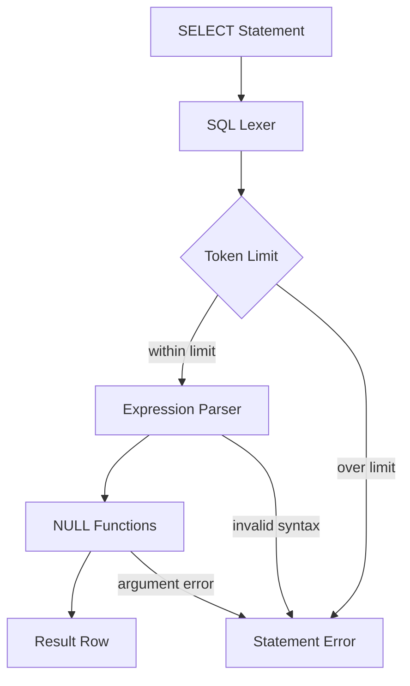

<!-- 2026-11-28T10:00:50Z -->
<h3>PR Summary by Qodo</h3>

Support NULL, COALESCE, and NULLIF in SELECT expressions

<!-- qodo-describe-risk-badge -->
<!-- /qodo-describe-risk-badge -->
<code>✨ Enhancement</code> <code>🧪 Tests</code> <code>📝 Documentation</code> <code>🕐 20-40 Minutes</code>


<details>
<summary>AI Description</summary>

<dl>
<dd>
<br/>

><pre>
>• Add NULL arithmetic, COALESCE, and NULLIF to SELECT expressions with argument validation.
>• Reject statements exceeding 1000 tokens to bound parser work.
>• Expand behavior tests and record an improved sqllogictest baseline of 5021 passing records.
></pre>

</dd>
</dl>

</details>

<!-- qodo-describe-risk-slot -->

<details>
<summary>Diagram</summary>

<dl>
<dd>

<br/>



</dd>
</dl>

</details>


<details>
<summary>High-Level Assessment</summary>

<dl>
<dd>

<br/>

>The following are alternative approaches to this PR:

<details>
<summary><b>1. Parse an expression tree before evaluation</b></summary>

<dl>
<dd>

- ➕ Separates syntax validation from evaluation and could support SQLite-style short-circuiting later.
- ➖ Adds an AST and a second traversal for a small expression grammar.
- ➖ Would need care to preserve the ticket&#x27;s required errors in arguments that SQLite skips.

</dd>
</dl>

</details>

>**Recommendation:** Keep eager evaluation for this ticket: it fits the existing parser and explicitly required argument-error behavior. Consider an expression tree if future functions require lazy evaluation.

</dd>
</dl>

</details>

<details>
<summary> Files changed (4) <code> +244 / -7 </code> </summary>

<dl>
<dd>

<br/>

<details>
<summary>Enhancement (1) <code> +232 / -2 </code></summary>

<dl>
<dd>

<details>
<summary>select.rs<code>Evaluate NULL, COALESCE, and NULLIF expressions</code> <code>+232/-2</code></summary>

<br/>

>Evaluate NULL, COALESCE, and NULLIF expressions
>
><pre>
>• Adds case-insensitive function parsing, NULL literals, arity checks, and a 1000-token statement limit. Adds tests for arithmetic, nested calls, invalid functions and arguments, eager errors, and depth and token boundaries.
></pre>
>
><a href='https://github.com/bettersandeep/lekha/pull/50/files#diff-8549d562271f291ad8b7a5ea6d1aa99b58f4986daeda596f8925d5c4d96a57a7'>src/select.rs</a>

</details>

</dd>
</dl>

</details>

<details>
<summary>Tests (1) <code> +1 / -1 </code></summary>

<dl>
<dd>

<details>
<summary>baseline.txt<code>Raise the recorded expression-test pass count</code> <code>+1/-1</code></summary>

<br/>

>Raise the recorded expression-test pass count
>
><pre>
>• Changes the expected passing count for random/expr/slt_good_0.test from 4577 to 5021.
></pre>
>
><a href='https://github.com/bettersandeep/lekha/pull/50/files#diff-2e40a4b8f2d140871be74a9d38ef9c05631da4b6e69028409ae22421fe54741b'>tests/slt/baseline.txt</a>

</details>

</dd>
</dl>

</details>

<details>
<summary>Documentation (2) <code> +11 / -4 </code></summary>

<dl>
<dd>

<details>
<summary>README.md<code>Document NULL functions and statement limits</code> <code>+9/-3</code></summary>

<br/>

>Document NULL functions and statement limits
>
><pre>
>• Describes NULL arithmetic, COALESCE and NULLIF behavior, eager argument errors, and the 1000-token limit. Updates the published sqllogictest score.
></pre>
>
><a href='https://github.com/bettersandeep/lekha/pull/50/files#diff-b335630551682c19a781afebcf4d07bf978fb1f8ac04c6bf87428ed5106870f5'>README.md</a>

</details>

<details>
<summary>lib.rs<code>Clarify supported SELECT expressions in API documentation</code> <code>+2/-1</code></summary>

<br/>

>Clarify supported SELECT expressions in API documentation
>
><pre>
>• Replaces the integer-arithmetic-only description with a reference to the README&#x27;s supported-expression list.
></pre>
>
><a href='https://github.com/bettersandeep/lekha/pull/50/files#diff-b1a35a68f14e696205874893c07fd24fdb88882b47c23cc0e0c80a30c7d53759'>src/lib.rs</a>

</details>

</dd>
</dl>

</details>

</dd>
</dl>

</details>

<!-- qodo-describe-head:3b715e7a38effe04cb69c8095c047a1b8575a5a7 -->

=====

<!-- 2026-11-28T10:02:05Z -->
<h3>Code Review by Qodo</h3>

<br/>

<details><summary><ins><strong>View medium (1)</strong></ins></summary><br/>


<details>
<summary>  1.  A 2000-column SELECT is rejected by the token limit <code>📘 Rule violation</code></summary>

<br/>

> <details>
><summary>Description</summary>
><br/>
>
><pre>
><b><i>select()</i></b> rejects statements above <b><i>MAX_TOKENS = 1000</i></b> before parsing, counting commas and
>operators against a statement-wide cap rather than the relevant construct limits. This rejects a
>501-column <b><i>SELECT</i></b> and prevents a 2000-column <b><i>SELECT</i></b>, a 1000-argument <b><i>COALESCE</i></b> call, and a
>1000-term flat sum from reaching their respective boundaries.
></pre>
></details>

> <details>
><summary>Agent prompt</summary>
><br/>
>
>```
>The issue below was found during a code review. Follow the provided context and guidance below and implement a solution
>
>## Issue description
>The statement-wide `MAX_TOKENS = 1000` check rejects valid queries before their column-count, function-argument, or expression-height limits can be evaluated.
>
>## Fix Focus Areas
>- src/select.rs[41-47]
>- src/select.rs[158-167]
>- src/select.rs[208-215]
>- src/select.rs[225-249]
>
>## Recommended Fix
>Remove the global token rejection, or make it non-binding for valid boundary cases. Enforce 2000 result columns in the SELECT list and 1000 arguments per function call, including in the COALESCE/NULLIF argument loop. Retain expression-depth protection by enforcing height 1000 on the expression tree: integer literals and NULL have height 1, and operators add one to their highest operand. Add regression tests for a valid 501-column query and for success at 2000 columns, 1000 COALESCE arguments, and 1000 flat-sum terms, with errors at 2001 columns, 1001 arguments, and 1001 terms.
>```
> <code>ⓘ Copy this prompt and use it to remediate the issue with your preferred AI generation tools</code>
></details>

[Dismiss ↗](https://app.qodo.ai/findings/4a53bc2e-a3fe-4342-a29e-d6c08cef7ca4?action=dismiss&origin=git) | [View ↗](https://app.qodo.ai/findings/4a53bc2e-a3fe-4342-a29e-d6c08cef7ca4)

</details>


</details>

<br/>

<!-- qodo-self-review-slot -->
<!-- https://github.com/bettersandeep/lekha/commit/3b715e7a38effe04cb69c8095c047a1b8575a5a7 -->


=====

