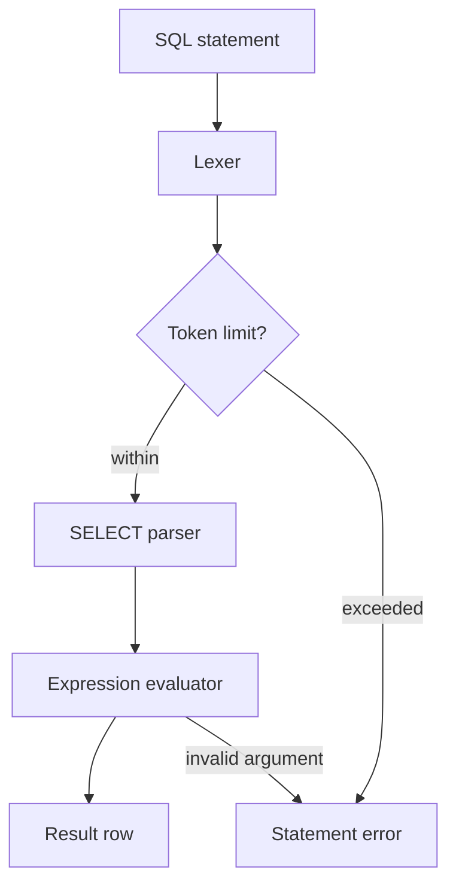

<!-- 2026-11-28T10:07:49Z 2026-11-28T10:07:49Z -->
<h3>PR Summary by Qodo</h3>

Support NULL, COALESCE, and NULLIF in SELECT expressions

<!-- qodo-describe-risk-badge -->
<!-- /qodo-describe-risk-badge -->
<code>✨ Enhancement</code> <code>🧪 Tests</code> <code>📝 Documentation</code> <code>🕐 20-40 Minutes</code>


<details>
<summary>AI Description</summary>

<dl>
<dd>
<br/>

><pre>
>• Support NULL arithmetic, COALESCE, and NULLIF in SELECT expressions.
>• Reject invalid function calls and statements exceeding 1000 tokens.
>• Expand parser tests and raise the SQL logic test baseline from 4577 to 5021.
></pre>

</dd>
</dl>

</details>

<!-- qodo-describe-risk-slot -->

<details>
<summary>Diagram</summary>

<dl>
<dd>

<br/>



</dd>
</dl>

</details>


<details>
<summary>High-Level Assessment</summary>

<dl>
<dd>

<br/>

>The following are alternative approaches to this PR:

<details>
<summary><b>1. Short-circuit COALESCE evaluation</b></summary>

<dl>
<dd>

- ➕ Matches SQLite when an unused argument would fail.
- ➖ Violates the ticket&#x27;s requirement that errors in every argument fail the statement.
- ➖ Requires separating argument parsing from evaluation.

</dd>
</dl>

</details>

<details>
<summary><b>2. Apply separate structural limits</b></summary>

<dl>
<dd>

- ➕ Preserves valid statements longer than 1000 tokens.
- ➖ Adds complexity to tracking nesting, argument counts, and result columns.

</dd>
</dl>

</details>

>**Recommendation:** Keep eager argument evaluation because it satisfies the explicit acceptance criteria, despite its documented difference from SQLite. The token cap is a simple conservative safeguard; consider separate structural limits only if longer valid statements need support.

</dd>
</dl>

</details>

<details>
<summary> Files changed (4) <code> +244 / -7 </code> </summary>

<dl>
<dd>

<br/>

<details>
<summary>Enhancement (1) <code> +232 / -2 </code></summary>

<dl>
<dd>

<details>
<summary>select.rs<code>Evaluate NULL and supported SQL functions</code> <code>+232/-2</code></summary>

<br/>

>Evaluate NULL and supported SQL functions
>
><pre>
>• Adds NULL literals and case-insensitive COALESCE and NULLIF calls to expression parsing, with arity checks and eager argument evaluation. Rejects statements over 1000 tokens and adds tests for results, errors, nesting, and token boundaries.
></pre>
>
><a href='https://github.com/bettersandeep/lekha/pull/52/files#diff-8549d562271f291ad8b7a5ea6d1aa99b58f4986daeda596f8925d5c4d96a57a7'>src/select.rs</a>

</details>

</dd>
</dl>

</details>

<details>
<summary>Tests (1) <code> +1 / -1 </code></summary>

<dl>
<dd>

<details>
<summary>baseline.txt<code>Raise the SQL logic test pass baseline</code> <code>+1/-1</code></summary>

<br/>

>Raise the SQL logic test pass baseline
>
><pre>
>• Changes the expected passing-record count for random/expr/slt_good_0.test from 4577 to 5021.
></pre>
>
><a href='https://github.com/bettersandeep/lekha/pull/52/files#diff-2e40a4b8f2d140871be74a9d38ef9c05631da4b6e69028409ae22421fe54741b'>tests/slt/baseline.txt</a>

</details>

</dd>
</dl>

</details>

<details>
<summary>Documentation (2) <code> +11 / -4 </code></summary>

<dl>
<dd>

<details>
<summary>README.md<code>Document NULL and function support</code> <code>+9/-3</code></summary>

<br/>

>Document NULL and function support
>
><pre>
>• Describes NULL arithmetic, COALESCE and NULLIF behavior, eager argument errors, and the 1000-token limit. Updates the reported SQL logic test score.
></pre>
>
><a href='https://github.com/bettersandeep/lekha/pull/52/files#diff-b335630551682c19a781afebcf4d07bf978fb1f8ac04c6bf87428ed5106870f5'>README.md</a>

</details>

<details>
<summary>lib.rs<code>Broaden the execute API documentation</code> <code>+2/-1</code></summary>

<br/>

>Broaden the execute API documentation
>
><pre>
>• Clarifies that SELECT without FROM supports the expressions documented in the README, rather than only integer arithmetic.
></pre>
>
><a href='https://github.com/bettersandeep/lekha/pull/52/files#diff-b1a35a68f14e696205874893c07fd24fdb88882b47c23cc0e0c80a30c7d53759'>src/lib.rs</a>

</details>

</dd>
</dl>

</details>

</dd>
</dl>

</details>

<!-- qodo-describe-head:3b715e7a38effe04cb69c8095c047a1b8575a5a7 -->

=====

<!-- 2026-11-28T10:08:47Z 2026-11-28T10:08:47Z -->
<h3>Code Review by Qodo</h3>

<br/>

<details><summary><ins><strong>View medium (1)</strong></ins></summary><br/>


<details>
<summary>  1.  Flat sums of 1000 terms are rejected as too long <code>📘 Rule violation</code></summary>

<br/>

> <details>
><summary>Description</summary>
><br/>
>
><pre>
>The <b><i>MAX_TOKENS</i></b> check in <b><i>select()</i></b> rejects statements exceeding 1000 tokens before parsing, rather
>than enforcing limits on expression height, function arguments, or result columns. This rejects a
>1000-term sum, a 1000-argument <b><i>COALESCE</i></b>, and a 2000-column SELECT that should succeed, while the
>corresponding over-limit cases fail at the token guard instead of exercising their respective
>boundaries.
></pre>
></details>

> <details>
><summary>Agent prompt</summary>
><br/>
>
>```
>The issue below was found during a code review. Follow the provided context and guidance below and implement a solution
>
>## Issue description
>The statement-wide 1000-token guard rejects supported queries before expression-height, function-argument, or result-column limits can be evaluated. A 1000-term sum, a 1000-argument COALESCE call, and a 2000-column SELECT must succeed; their respective 1001-term, 1001-argument, and 2001-column cases must fail at the applicable boundary.
>
>## Fix Focus Areas
>- src/select.rs[41-47]
>- src/select.rs[178-200]
>- src/select.rs[210-216]
>- src/select.rs[566-590]
>- README.md[70-70]
>
>## Recommended Fix
>Remove the statement-wide token guard and its documentation. Enforce expression height at most 1000, reject a function call when adding an argument would exceed 1000, and enforce the 2000-column limit in the select-list parsing loop. Replace or update `long_statement_is_an_error` with boundary tests confirming that 1000-term sums, 1000-argument COALESCE calls, and 2000-column SELECTs succeed, while the corresponding 1001-term, 1001-argument, and 2001-column cases fail; include a supported SELECT list exceeding 1000 tokens as a regression test.
>```
> <code>ⓘ Copy this prompt and use it to remediate the issue with your preferred AI generation tools</code>
></details>

[Dismiss ↗](https://app.qodo.ai/findings/0317801d-2b2c-4752-ab4b-5e7fc9d3eca4?action=dismiss&origin=git) | [View ↗](https://app.qodo.ai/findings/0317801d-2b2c-4752-ab4b-5e7fc9d3eca4)

</details>


</details>

<br/>

<!-- qodo-self-review-slot -->


<!-- qodo-context:start -->
<details><summary><strong>Context sources</strong></summary>

<div>&#x2705; Tickets: <a href="https://github.com/bettersandeep/lekha/issues/10"><code>🎫 NULL, COALESCE and NULLIF in SELECT without FROM</code></a></div>
<div>&#x26A0;&#xFE0F; Tickets: not configured — No jira, linear integration is connected for the linked tickets</div>
<div>&#x2705; Compliance rules (platform): <a href="https://app.qodo.ai/rules?state=active&amp;scopes=/bettersandeep/lekha/"><code>42 rules</code></a></div>
<div>&#x2705; Skills: <a href="https://app.qodo.ai/rules?tab=skills&amp;state=active"><code>unseen-check</code></a></div>
<div>Review mode: <code>Auto: ⚖️ Balanced</code>: Substantial parser behavior with contract scope and an unrequested token limit.</div>
<!-- qodo-context:end -->
</details>

<br/>
<!-- https://github.com/bettersandeep/lekha/commit/3b715e7a38effe04cb69c8095c047a1b8575a5a7 -->


=====

